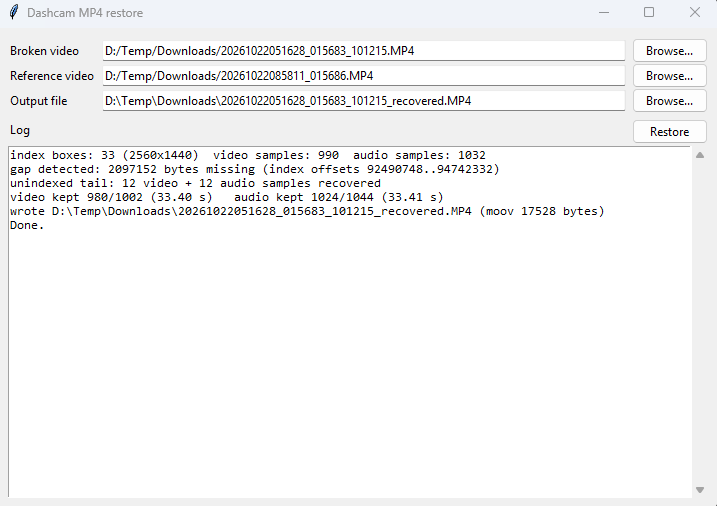

# dashcam-restore

Rebuilds the missing `moov` atom of broken Novatek-style dashcam MP4 files (recording cut off, no `moov`).
It uses the camera's own `nidx` index boxes plus a working reference clip from the same camera and settings.
Detects and skips missing data blocks, recovers the unindexed tail.

## Use

```
uv run dashcam-restore BROKEN.MP4 --ref WORKING.MP4 [-o OUT.MP4] [--creation-time ISO] [--max-lost N] [--no-tail]
```

GUI: `uv run dashcam-restore-gui` or `dist\dashcam-restore-gui.exe` (pick broken/reference/output files, live log).



## Standalone exe

Run `build_exe.bat`. Output: `dist\dashcam-restore.exe` and `dist\dashcam-restore-gui.exe`.
